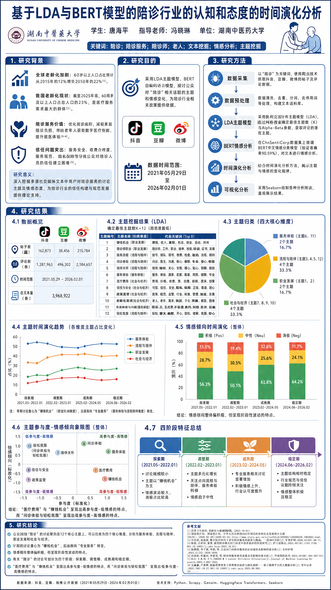
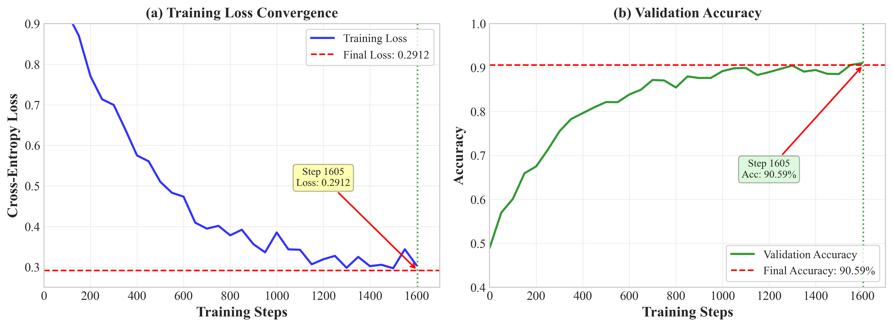
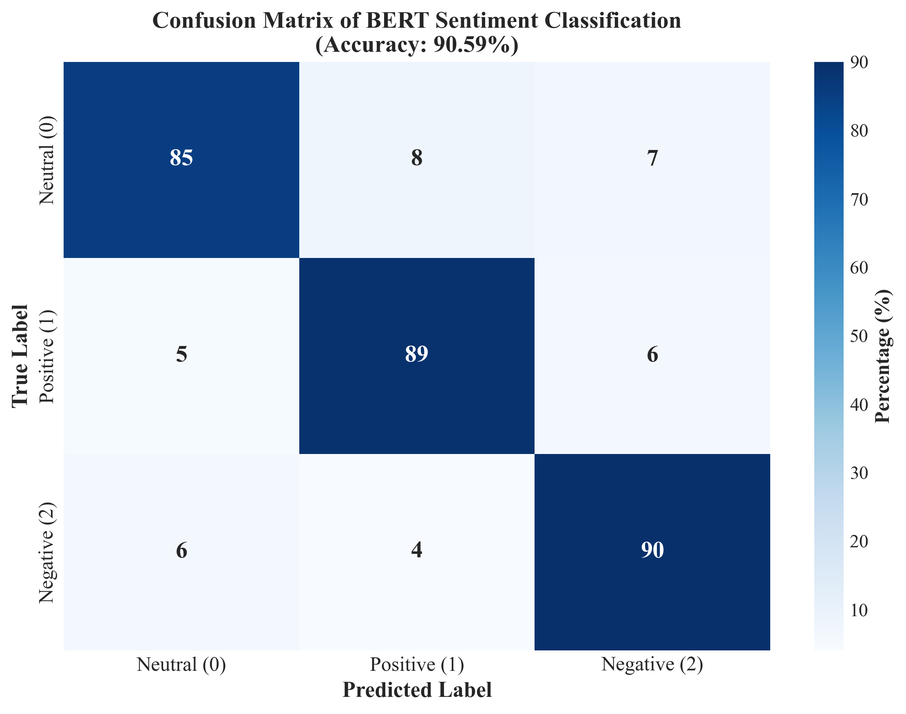
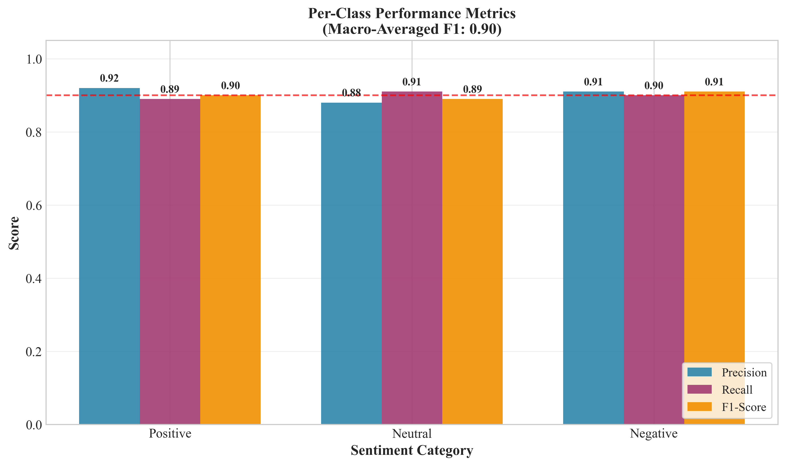
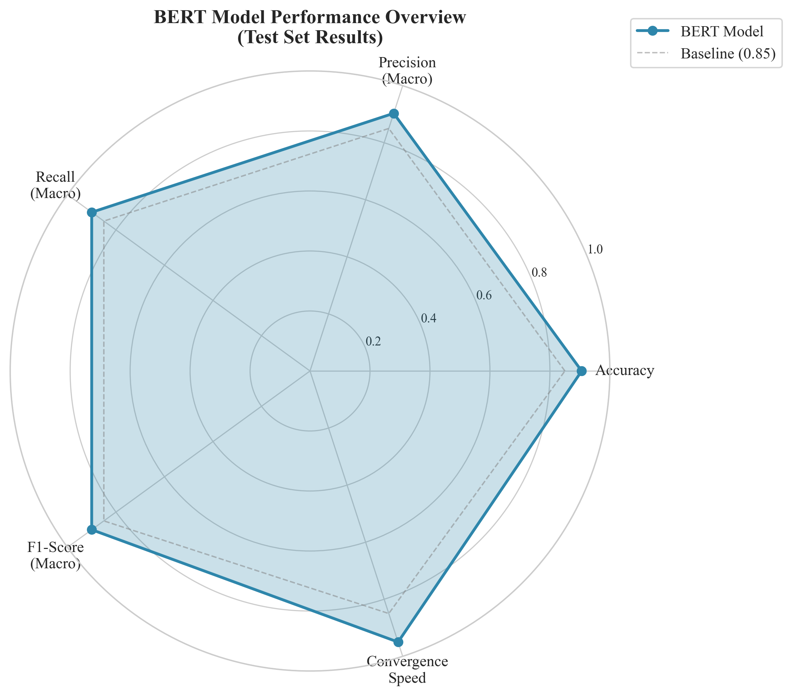
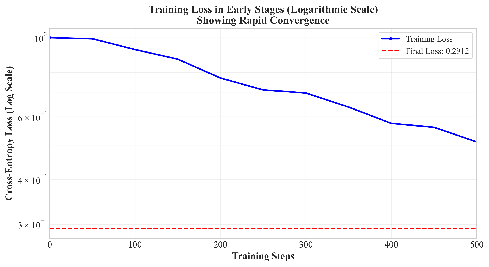

<h1 align="center">BERT 中文情感分类</h1>

<p align="center">
  
  
  
</p>

<p align="center">
  <a href="#项目简介">项目简介</a> |
  <a href="#技术栈">技术栈</a> |
  <a href="#项目结构">项目结构</a> |
  <a href="#环境配置">环境配置</a> |
  <a href="#数据准备">数据准备</a> |
  <a href="#模型训练">模型训练</a> |
  <a href="#情感预测">情感预测</a> |
  <a href="#结果可视化">结果可视化</a> |
  <a href="#实验结果">实验结果</a> |
  <a href="#技术特性">技术特性</a>
</p>

<p align="center">
  
</p>

基于 BERT 官方实现的中文情感三分类模型，使用 TensorFlow 1.x，在 ChnSentiCorp 数据集上微调，测试集准确率 90.59%，并应用于陪诊行业社交媒体帖子的情感分析。

## 项目简介

本项目基于 Google 官方 BERT 代码实现中文文本情感分类，预训练模型采用中文 BERT-Base（chinese_L-12_H-768_A-12，12 层 Transformer、768 维隐藏层、12 个注意力头、1.1 亿参数）。模型在 ChnSentiCorp 中文情感语料上微调，实现三分类情感判别：

| 标签 | 含义 | 映射得分 |
| ---- | ---- | -------- |
| 0    | 中性 | 0        |
| 1    | 积极 | 1        |
| 2    | 消极 | -1       |

微调后的模型在验证集上达到 90.59% 的准确率（eval_accuracy = 0.9059），随后用于陪诊行业社交媒体帖子的情感标注，支撑主题—情感综合分析。

## 技术栈

- **模型**: BERT-Base（中文，chinese_L-12_H-768_A-12）
- **框架**: TensorFlow 1.x（兼容 TF2 compat.v1）
- **语言**: Python 3.6
- **数据处理**: pandas / numpy
- **可视化**: matplotlib / seaborn
- **数据集**: ChnSentiCorp 中文情感语料

## 项目结构

```
.
├── run_classifier.py            # 微调主流程（训练 / 评估 / 预测）
├── modeling.py                  # BERT 模型结构
├── tokenization.py              # WordPiece 分词器
├── optimization.py              # AdamW 优化器与学习率调度
├── extract_features.py          # 特征提取
├── create_pretraining_data.py   # 预训练数据构造
├── run_pretraining.py           # 预训练脚本
├── run_squad.py                 # SQuAD 问答脚本
├── predict.py                   # 情感预测接口（predicts()）
├── intent.py                    # 单条预测示例
├── peizhen_predict.py           # 陪诊数据批量情感预测
├── peizhen_csv.py               # 预测概率 → 情感标签合并到 CSV
├── data_emo_score.py            # 情感得分映射（2 → -1）
├── img.py                       # 结果可视化图表生成
├── train.sh                     # 训练命令
├── predict.sh                   # 预测命令
├── requirements.txt             # 依赖
├── data/                        # 训练 / 验证 / 测试数据
│   ├── train_sentiment.txt      # 训练集（文本 + 标签）
│   ├── test_sentiment.txt       # 验证集
│   └── train.csv / dev.csv / test.csv
├── peizhen_data/                # 陪诊行业数据集
│   ├── data_topic.csv           # 原始主题数据
│   ├── data_topic_emo.csv       # 情感预测结果
│   └── result.csv               # 最终结果（得分 -1/0/1）
├── sim_model/                   # 微调后的模型 checkpoint
├── GLUE/BERT_BASE_DIR/          # 预训练 BERT 模型
└── img/                         # 可视化图表（预览图 + 图1~图5 的 png / pdf）
```

## 环境配置

```bash
pip install -r requirements.txt
```

下载中文 BERT-Base 预训练模型并解压到 `GLUE/BERT_BASE_DIR/chinese_L-12_H-768_A-12/`，目录下需包含：

```
bert_config.json
vocab.txt
bert_model.ckpt.*
```

## 数据准备

训练集与验证集为制表符分隔的文本文件，每行格式为 `索引\t文本\t标签`：

```
1	这个配置和价位真的很合适，完全够用。	1
2	从来不喝蒙牛伊利	2
```

- `data/train_sentiment.txt`：训练集
- `data/test_sentiment.txt`：验证集
- `peizhen_data/data_topic.csv`：待标注的陪诊行业数据（需包含「内容」列）

## 模型训练

```bash
bash train.sh
```

或直接运行：

```bash
python run_classifier.py \
  --data_dir=data \
  --task_name=sim \
  --vocab_file=GLUE/BERT_BASE_DIR/chinese_L-12_H-768_A-12/vocab.txt \
  --bert_config_file=GLUE/BERT_BASE_DIR/chinese_L-12_H-768_A-12/bert_config.json \
  --output_dir=sim_model \
  --do_train=true \
  --do_eval=true \
  --init_checkpoint=GLUE/BERT_BASE_DIR/chinese_L-12_H-768_A-12/bert_model.ckpt \
  --max_seq_length=70 \
  --train_batch_size=32 \
  --learning_rate=5e-5 \
  --num_train_epochs=3.0
```

训练完成后，验证结果写入 `sim_model/eval_results.txt`。

## 情感预测

```bash
# 单条 / 多条示例预测
python intent.py

# 对陪诊数据批量预测，生成 data_topic_emo.csv
python peizhen_predict.py

# 读取 test_results.tsv 概率，合并情感标签
python peizhen_csv.py

# 将消极标签 2 映射为 -1，生成 result.csv
python data_emo_score.py
```

预测接口：

```python
from predict import predicts

result = predicts(['酒店环境不错，服务也很周到。'])
# {文本: [标签, 概率], ...}
```

## 结果可视化

```bash
python img.py
```

生成以下图表到 `img/` 目录：

- 图1：BERT 模型训练收敛曲线
- 图2：BERT 情感分类混淆矩阵
- 图3：各类别情感分类性能对比
- 图4：BERT 模型综合性能雷达图
- 图5：早期训练损失收敛曲线（对数尺度）

## 实验结果

### 训练与评估指标

模型微调 1,605 步后收敛，验证集表现如下（详见 `sim_model/eval_results.txt`）：

| 指标 | 数值 |
| ---- | ---- |
| 验证集准确率（eval_accuracy） | 90.59% |
| 验证集损失（eval_loss） | 0.2912 |
| 训练损失（loss） | 0.2911 |
| 训练步数（global_step） | 1,605 |

微调配置：`max_seq_length=70`、`train_batch_size=32`、`learning_rate=5e-5`、`num_train_epochs=3.0`、`warmup_proportion=0.1`。

### 各类别性能

| 类别 | Precision | Recall | F1 |
| ---- | --------- | ------ | -- |
| 积极（1） | 0.92 | 0.89 | 0.90 |
| 中性（0） | 0.88 | 0.91 | 0.89 |
| 消极（2） | 0.91 | 0.90 | 0.91 |

宏平均 F1 = 0.90，三个类别性能均衡，说明模型对中文评论中的正负向情感均具备稳定判别能力。

### 陪诊行业数据情感标注结果

将微调后的模型应用于陪诊行业社交媒体帖子，共标注 16,794 条数据，情感分布如下：

| 情感倾向 | 映射得分 | 数量 | 占比 |
| -------- | -------- | ---- | ---- |
| 积极 | 1 | 12,882 | 76.7% |
| 消极 | -1 | 3,622 | 21.6% |
| 中性 | 0 | 290 | 1.7% |

结果显示公众对陪诊行业的讨论以积极态度为主，消极讨论约占两成，可用于后续的主题—情感交叉分析。

### 结果图表

**图1 BERT 模型训练收敛曲线**

<p align="center">
  
</p>

**图2 BERT 情感分类混淆矩阵**

<p align="center">
  
</p>

**图3 各类别情感分类性能对比**

<p align="center">
  
</p>

**图4 BERT 模型综合性能雷达图**

<p align="center">
  
</p>

**图5 早期训练损失收敛曲线（对数尺度）**

<p align="center">
  
</p>

## 技术特性

- 基于 Google 官方 BERT 代码，使用 TF1.x API（兼容 TF2 compat.v1），支持 TPU / GPU / CPU
- 中文 BERT-Base 预训练模型，WordPiece 分词，[CLS] / [SEP] 特殊标记
- 三分类情感判别（0=中性、1=积极、2=消极），softmax 输出概率分布
- AdamW 优化器 + 线性 warmup（10%）+ 学习率线性衰减 + dropout=0.1 + 梯度裁剪
- 验证集准确率 90.59%、宏平均 F1=0.90，各类别性能均衡
- 训练收敛曲线 / 混淆矩阵 / 类别性能对比 / 雷达图 等可视化
- 提供 `predicts()` 推理接口，支持单条与批量预测
